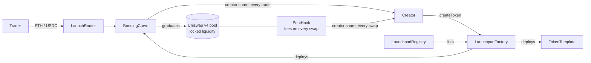

<p align="center">
  
</p>

<h1 align="center">Letsprint.ink contracts</h1>

<p align="center">
  The creator-first token launchpad on <a href="https://inkonchain.com">Ink</a>. Creators earn on every trade, before and after graduation.
</p>

<p align="center">
  <a href="https://letsprint.ink">Website</a> ·
  <a href="https://x.com/LetsPrintInk">X</a> ·
  <a href="https://discord.gg/dZzN3CZc6m">Discord</a> ·
  <a href="#deployments">Deployments</a> ·
  <a href="SECURITY.md">Security</a>
</p>

<p align="center">
  <a href="https://github.com/LetsPrintInk/Contracts/actions/workflows/test.yml"></a>
  
  
  
  
  
  
</p>

---

## How it works

1. **Launch.** A creator launches a coin in one transaction: a fixed 1B supply ERC-20 with no owner and no mint, plus its own bonding curve. The creator's optional first buy happens inside the same transaction, so no one can get in first.
2. **Trade on the curve.** 800M tokens are sold along the curve for ETH, USDC or a tokenized stock (xStock). Every trade pays the creator inside the same transaction.
3. **Graduate.** The buy that sells out the curve moves the coin, with the other 200M tokens, into a **full-range Uniswap v4 pool whose liquidity is locked forever**. This happens in the same transaction, so there is never a gap where trading stops.
4. **Keep earning.** In the pool, the Letsprint hook charges the same fee and creator tax on every swap, so creators keep earning for the life of the coin.



## Deployments

**Ink mainnet** (chain ID 57073). Every contract is verified on the [Ink explorer](https://explorer.inkonchain.com) with an exact source match. The same list is in [`deployments/ink-mainnet.json`](deployments/ink-mainnet.json).

| Contract | Address | What it does |
| --- | --- | --- |
| LaunchpadFactory | [`0xd88C543Ddae849091F2160bba5881230c30E1634`](https://explorer.inkonchain.com/address/0xd88C543Ddae849091F2160bba5881230c30E1634) | Launches coins, takes the anti-spam fee, sells Spotlight slots |
| LaunchRouter | [`0x6874D1e52D4E58865da08D99362f490fF6a01fd8`](https://explorer.inkonchain.com/address/0x6874D1e52D4E58865da08D99362f490fF6a01fd8) | Buy and sell with ETH, USDC or the xStock. Holds nothing |
| PrintHook | [`0xe1e2E5Bd7043322fd8aB7484ca01Dbb9ef83a0cC`](https://explorer.inkonchain.com/address/0xe1e2E5Bd7043322fd8aB7484ca01Dbb9ef83a0cC) | Uniswap v4 hook: fee and creator tax on every pool swap. No owner |
| LaunchpadRegistry | [`0xc160252339e2bb31f67673ecE2b78AefA0CcE66d`](https://explorer.inkonchain.com/address/0xc160252339e2bb31f67673ecE2b78AefA0CcE66d) | Lists every factory version |
| CurveDeployer | [`0x113191EE86a43167c67b1435b9A780a08E5Afc07`](https://explorer.inkonchain.com/address/0x113191EE86a43167c67b1435b9A780a08E5Afc07) | Holds the curve code; usable only by the factory |
| TokenDeployer | [`0xA1C184af5b4de1f78EFe34A6C8983e168efd2024`](https://explorer.inkonchain.com/address/0xA1C184af5b4de1f78EFe34A6C8983e168efd2024) | Holds the token code; usable only while a curve is being built |
| StockVaultDeployer | [`0x9c166Ae921a4E860Aa9b04F1679aA9544ACC2331`](https://explorer.inkonchain.com/address/0x9c166Ae921a4E860Aa9b04F1679aA9544ACC2331) | Creates one non-rebasing vault per xStock |
| TimelockController | [`0xaB2a18F4B22B42B1E2ca435d61E573180E6B54F6`](https://explorer.inkonchain.com/address/0xaB2a18F4B22B42B1E2ca435d61E573180E6B54F6) | Owns the factory and registry |
| Team Safe | [`0x51e854BbD6aB86D065BCD5B1D55A935336c92A38`](https://explorer.inkonchain.com/address/0x51e854BbD6aB86D065BCD5B1D55A935336c92A38) | Runs the timelock; also the treasury |

External contracts used: Uniswap v4 PoolManager `0x360E68faCcca8cA495c1B759Fd9EEe466db9FB32`, WETH `0x4200000000000000000000000000000000000006`, USDC `0x2D270e6886d130D724215A266106e6832161EAEd`.

## Fees

| | Rate | Who gets it |
| --- | --- | --- |
| Trading fee | 1% of every buy and sell, on the curve and in the pool | 70% creator, 30% treasury |
| Creator tax | 0% to 10%, chosen by the creator at launch; **can only ever be lowered** | 100% creator |
| Launch tax | 98% at second 0, then 24.5%, 6.1%, 1.5%, 0.4%, and 0% from second 5. Creator's first buy and declared team wallets are exempt | 70% creator, 30% treasury |
| Launch fee | 0.0005 ETH | Treasury (anti-spam) |

Creators can split their earnings across up to 5 wallets. A payout that fails (for example a wallet blocked by Circle) never stops trading: it is held for that wallet to claim.

## Coins and curves

| | ETH pairs | USDC pairs |
| --- | --- | --- |
| Supply | 1,000,000,000 (800M on the curve, 200M to the pool) | same |
| Graduates at | 5 ETH raised | 12,800 USDC raised |
| Market cap at start and at graduation | 0.3125 × and 5 × the amount raised | $4,000 to $64,000 |

The buy that sells out the curve gets only the tokens left, pays only for those and is refunded the rest.

## Trust model

- **Coins, curves and the hook have no owner.** No one can mint, pause trading, change a coin's rules or touch its liquidity.
- **Pool liquidity is locked forever.** The graduated position is owned by the curve, which has no function to remove it.
- **The factory and registry are owned by a timelock run by the team Safe.** The owner can only change settings for *future* launches (fees within hard caps, pair assets, Spotlight prices, pausing new launches); each curve copies its settings into immutables when it is created. Ownership can be handed over but never renounced, so pause and rescue always stay possible.
- **Hard caps in code:** launch fee ≤ 0.05 ETH, creator tax ≤ 10%, ETH graduation between 0.5 and 100 ETH, USDC graduation between $1,000 and $250,000.

## Security

No external audit yet. Instead:

- **Independent review.** Separate reviewers each took one part, and every finding had to be proven with a Foundry attack test. No one found a way to steal funds, and every confirmed issue is fixed. See the [review table](docs/DEPLOYMENT.md#independent-review-13-october-2026).
- **Invariant and fuzz testing.** 100,000 random calls with zero violations of solvency, `k`-monotonicity and reserve invariants, plus 1,000-run fuzz tests on every pricing path.
- **Fork tests** against the real PoolManager, WETH and USDC on Ink, covering the full lifecycle.
- **Static analysis** with Slither, Aderyn and forge lint. Every remaining finding is explained in [docs/DEPLOYMENT.md](docs/DEPLOYMENT.md#static-analysis).
- **Mainnet test.** A real launch, buy and sell on Ink after deployment.

Found something? See [SECURITY.md](SECURITY.md) and email **hello@letsprint.ink**. Please don't open a public issue.

## Repository

```
src/
  LaunchpadFactory.sol   launches, fees, Spotlight, pair assets
  BondingCurve.sol       one per coin: curve trading, payouts, graduation into Uniswap v4
  TokenTemplate.sol      fixed-supply ERC-20 with permit, burn and updatable socials
  PrintHook.sol          Uniswap v4 hook charging fees on graduated pools
  LaunchRouter.sol       ETH / USDC / xStock entry points
  StockVault.sol         ERC-4626 wrapper per xStock, and its deployer
  Deployers.sol          CurveDeployer and TokenDeployer (keep every contract under 24 KB)
  LaunchpadRegistry.sol  factory versions
test/                    invariants, fuzz, hook, regression and Ink fork tests
script/                  Deploy.s.sol, Smoke.s.sol, rehearse.sh
deployments/             deployed addresses
docs/DEPLOYMENT.md       settings, test results, review findings, deployment runbook
```

## Build and test

Requires [Foundry](https://book.getfoundry.sh) and npm.

```bash
npm install                 # OpenZeppelin 5.6.1, Uniswap v4-core 1.0.2, v4-periphery 1.0.3
forge build --sizes
forge test --no-match-path test/Fork.t.sol
forge test --match-path test/Fork.t.sol --fork-url https://rpc-gel.inkonchain.com -vv
```

Compiler settings (solc 0.8.26, via IR, EVM cancun, 200 optimizer runs) match the deployed bytecode exactly.

## License

[MIT](LICENSE)
